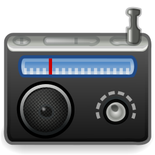

# Gradio
A GTK4 app for finding and listening to internet radio stations.



[](https://github.com/sfesenko/Gradio/actions/workflows/ci.yml)
[](https://github.com/sfesenko/Gradio/releases/)
[](https://www.gnu.org/licenses/gpl-3.0)

## News
* **Gradio 8.0** is a GTK4 rewrite with Google Cast support.

## General Information
* **Build**
  ```bash
  meson setup _build
  meson compile -C _build
  meson test -C _build
  ./_build/gradio
  ```

* **License**
  GNU General Public License, Version 3. See [LICENSE.md](LICENSE.md).
